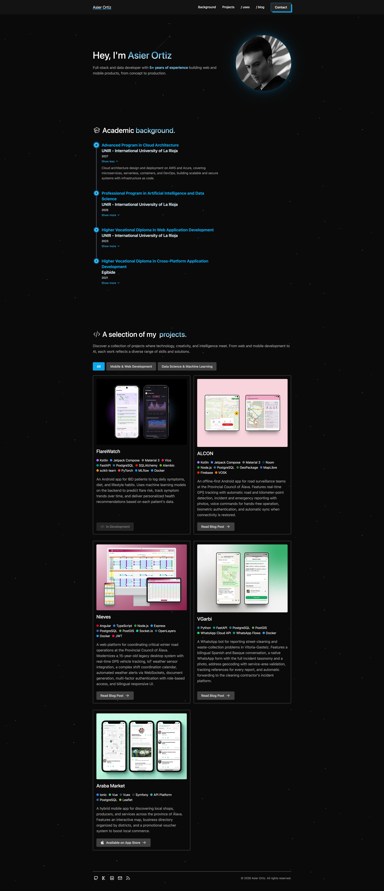
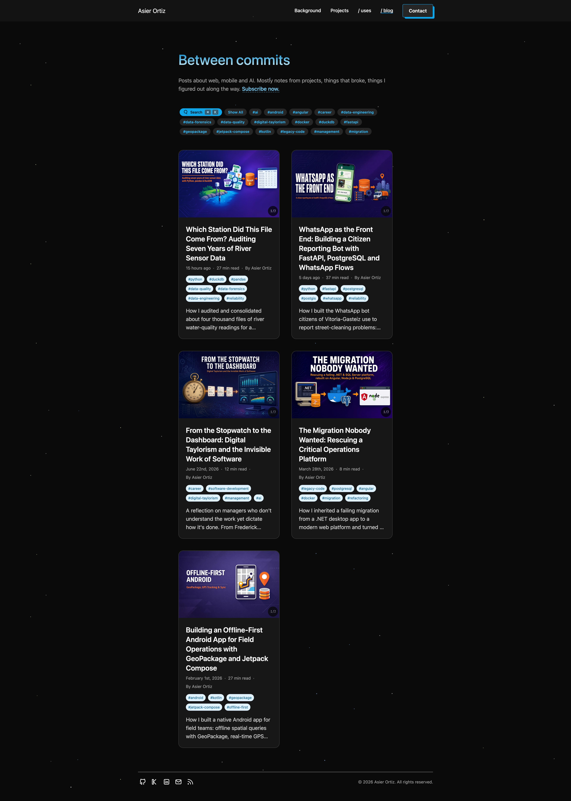

# asierortiz.com

[](https://conventionalcommits.org)
[](LICENSE)
[](https://github.com/semantic-release/semantic-release)
[](https://github.com/asier-ortiz/asierortiz.com/actions/workflows/release.yml)
[](https://github.com/asier-ortiz/asierortiz.com/actions/workflows/validate-feed.yml)
[](https://github.com/asier-ortiz/asierortiz.com/actions/workflows/check-links.yml)
[](https://github.com/asier-ortiz/asierortiz.com/actions/workflows/accessibility.yml)

This repository contains the source code for my personal portfolio and blog: [asierortiz.com](https://asierortiz.com/).

---

## About the Project

My personal website showcases my work, projects, and technical blog.

It features:

- **Hero Section**: A short introduction and a portrait.
- **Projects**: Selected projects with screenshots and descriptions, linking to the write-up or the app where there is one.
- **Academic Background**: The diplomas and programs I have studied, as a timeline.
- **Blog**: Write-ups of real projects I've built (field apps, data pipelines, integrations) and the occasional essay on the craft.
- **Tools & Setup**: The editor, terminal, languages, services and hardware I work with every day.
- **Newsletter Subscription**: Visitors can subscribe via [Buttondown](https://buttondown.com/asierortiz/).
- **Contact**: Links to my email and social media profiles in the footer of every page.

---

## Technologies Used

- [Astro](https://astro.build/)
- [Vue 3](https://vuejs.org/) (for interactive islands)
- [Fuse.js](https://fusejs.io/) (for full-text fuzzy search within the blog)
- [Tailwind CSS](https://tailwindcss.com/)
- [TypeScript](https://www.typescriptlang.org/)
- [Netlify](https://www.netlify.com/) (Continuous Deployment is set up through GitHub integration)

---

## CI/CD Workflows

This project uses GitHub Actions to ensure code quality and automate deployment:

- **Semantic Release**: Automatically determines the next version, updates the changelog, tags the release, and publishes it to GitHub based on commit messages.
- **Validate RSS Feed**: Checks that the generated RSS feed (`/rss.xml`) is valid after each push.
- **Check Broken Links**: Scans the site for broken links after each build to ensure reliability.
- **Check Accessibility**: Builds the site and runs [axe-core](https://github.com/dequelabs/axe-core) through [Playwright](https://playwright.dev/) on every page, at desktop and phone widths, failing on any WCAG 2.2 A or AA rule. Automated rules catch only part of WCAG; the rest needs manual review.
- **Continuous Deployment**: Netlify builds and deploys every push to `main` on its own. It does not wait for the checks above, which flag a failing commit instead.

---

## Getting Started

Clone and Run Locally (requires Node.js 22 or later; the workflows use 24):

```bash
git clone https://github.com/asier-ortiz/asierortiz.com.git
cd asierortiz.com
npm install
npm run dev
```

### Available Commands

| Command                    | Action                                              |
|:---------------------------|:----------------------------------------------------|
| `npm install`              | Install dependencies                                |
| `npm run dev`              | Start local development server at `localhost:3000`  |
| `npm run build`            | Build the production site into `./dist/`            |
| `npm run preview`          | Preview the production build locally                |
| `npm run format`           | Format code using Prettier                          |
| `npm run test:a11y`        | Build the site and run the accessibility checks     |
| `npm run astro ...`        | Run CLI commands like `astro add`, `astro check`    |
| `npm run astro -- --help`  | Get help using the Astro CLI                        |

`npm run test:a11y` needs the Chromium build Playwright drives: install it once with `npx playwright install chromium`.

---

## Screenshots

<table style="border: none; border-collapse: collapse;">
  <tr>
    <td align="center" style="border: none;">
      
    </td>
    <td align="center" style="border: none;">
      
    </td>
  </tr>
</table>

---

## License

The source code is licensed under the [MIT License](./LICENSE).

The content is not: blog posts, images, diagrams and other written material under `src/content/`, `src/assets/` and `public/assets/` are © Asier Ortiz, all rights reserved. Quote with attribution and a link; ask before republishing.

---

## Contact

If you have any questions, suggestions, or just want to say hello:

- [hello@asierortiz.com](mailto:hello@asierortiz.com)

---

> Thank you for visiting my portfolio and blog!
